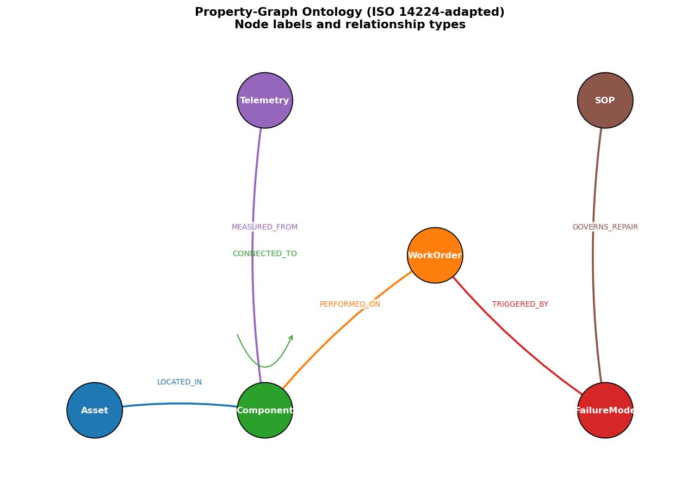
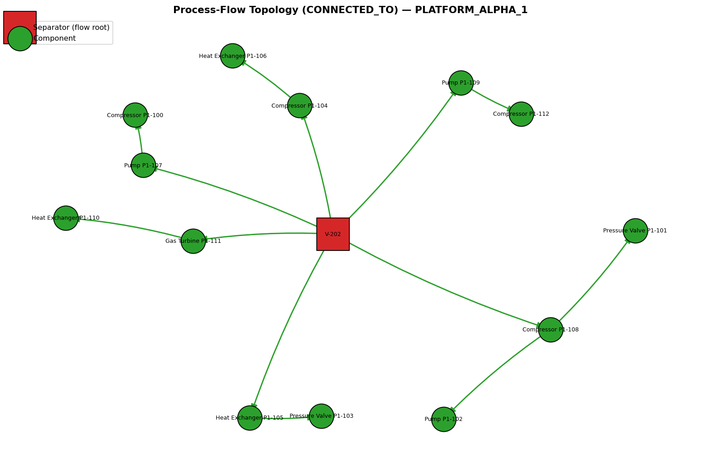
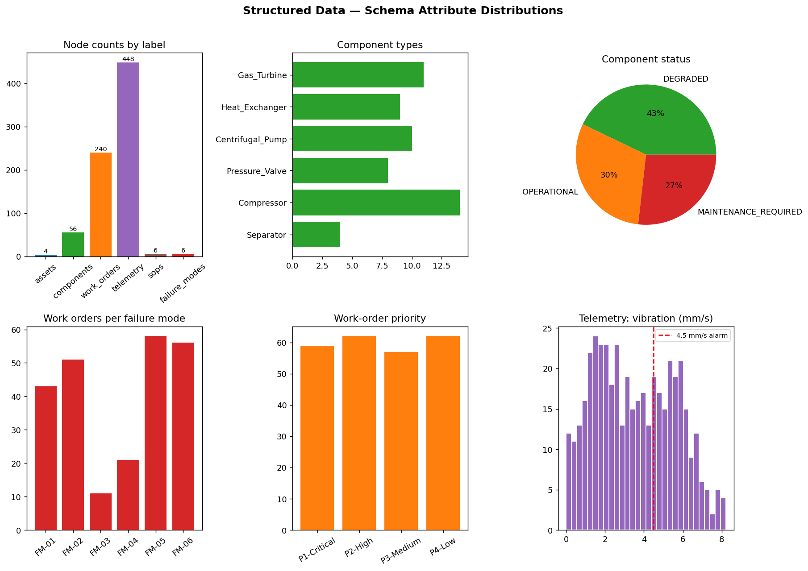
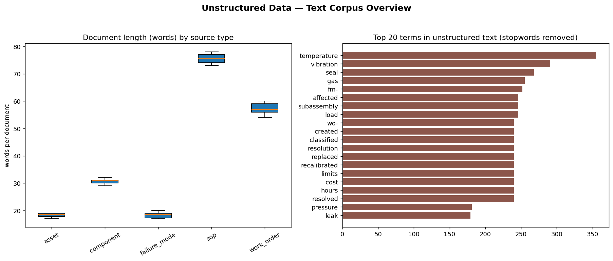

# Graph-RAG for Grounded Decision Support in Energy Infrastructure Maintenance

> BITS Pilani Dissertation — *Graph-RAG Architectures for Grounded Decision Support in
> Massive Energy Infrastructure Maintenance (Shell Context)*

This repository implements an end-to-end **Graph-RAG** pipeline that links high-level
technical documentation (SOPs, work orders) with fine-grained asset topology and
operational telemetry to answer maintenance-engineering questions in a *grounded* way.

It is built to run **fully locally with zero external services** (NetworkX graph backend,
in-process vector index, optional local LLM via Ollama), while also supporting a real
**Neo4j** backend and a **local LLM** when you have them.

It also ships a **data-schema visualization** layer — a Jupyter notebook, a CLI script,
and a Streamlit tab — that plots both the **structured** property graph (ontology,
topology, attribute distributions) and the **unstructured** text corpus. See
[Visualizing the data schema](#visualizing-the-data-schema).

---

## Why Graph-RAG?

Standard "naive" vector RAG chunks text and retrieves by semantic similarity. In energy
infrastructure, the hard questions are *topological*:

> "What are the failure modes for pumps connected downstream of Separator V-202?"

Answering this requires traversing an asset graph (`CONNECTED_TO`, `LOCATED_IN`,
`TRIGGERED_BY`, `GOVERNS_REPAIR`), not just matching keywords. This project builds both a
**naive vector RAG baseline** and a **hybrid Graph-RAG** engine, then evaluates them on a
50-question ground-truth benchmark.

---

## Architecture

```
                    ┌─────────────────────────────────────────────┐
                    │              Synthetic Data Gen               │
                    │  components · work orders · telemetry · SOPs  │
                    │        failure modes · graph topology         │
                    └───────────────────┬───────────────────────────┘
                                         │
             ┌───────────────────────────┴──────────────────────────┐
             ▼                                                        ▼
 ┌──────────────────────┐                             ┌──────────────────────────┐
 │  Knowledge Graph      │                             │     Vector Index          │
 │  (NetworkX / Neo4j)   │                             │ (sentence-transformers or │
 │  Nodes + Edges        │                             │  hashing fallback + FAISS)│
 └───────────┬──────────┘                             └────────────┬─────────────┘
             │  Cypher-style subgraph traversal                    │ top-k chunks
             └──────────────────────┬──────────────────────────────┘
                                     ▼
                      ┌──────────────────────────────┐
                      │   Hybrid Context Fusion        │
                      │   + Grounding / constraint     │
                      │     checking layer             │
                      └──────────────┬─────────────────┘
                                     ▼
                      ┌──────────────────────────────┐
                      │   LLM synthesis (Ollama) or    │
                      │   extractive fallback          │
                      └──────────────┬─────────────────┘
                                     ▼
              ┌──────────────────────────────────────────────┐
              │  RAGAS-style evaluation  ·  Streamlit UI       │
              │  routing agent (vector / graph / hybrid)       │
              │  data-schema visualization (notebook/plots)    │
              └────────────────────────────────────────────────┘
```

---

## Project layout

```
src/graphrag/
  config.py            Central config (paths, model names, backend toggles)
  schema.py            ISO 14224-adapted ontology: node labels, edges, dataclasses
  data_generation.py   Synthetic data generators (Faker-style, no hard deps)
  graph_store.py       Graph backend abstraction (NetworkX default, Neo4j optional)
  ingest.py            Load generated data -> graph + text corpus
  embeddings.py        Embedding backends (sentence-transformers or hashing fallback)
  vector_store.py      Vector index (FAISS if present, numpy fallback)
  retrieval.py         Vector retriever, graph retriever, hybrid retriever
  grounding.py         Constraint-checking / grounding layer
  llm.py               LLM abstraction (Ollama) + extractive fallback
  rag.py               NaiveVectorRAG baseline + GraphRAG engine
  router.py            LangGraph-style routing agent (rule-based)
  benchmark.py         50-question ground-truth benchmark generator
  evaluation.py        RAGAS-style metrics (faithfulness, precision, recall, relevance)
  pipeline.py          Orchestration: build everything end to end

  visualization.py     Data-schema plots (ontology, graph, topology, text) via matplotlib

scripts/
  generate_data.py
  build_index.py
  visualize.py         Render all data-schema figures to data/figures/
  run_query.py
  run_evaluation.py

app/streamlit_app.py   Interactive dashboard ("Ask" + "Data schema" tabs)
notebooks/
  01_data_schema_exploration.ipynb   Notebook walkthrough of the data schema + plots
tests/                 Unit tests (core + visualization)
data/                  Generated datasets + built indexes + figures (gitignored)
docs/                  Ontology + methodology notes
  figures/             Committed sample figures shown in the README
```

---

## How to run — step by step

> **Requirements:** Python 3.9+ and nothing else. The core pipeline uses only the Python
> standard library. Optional extras (Neo4j, Ollama, sentence-transformers, FAISS,
> Streamlit) upgrade individual components but are never required.
>
> Run every command **from the repository root** (the folder containing this README).
> All script commands use `python -m scripts.<name>` so Python can resolve the package.

### Step 0 — Create and activate a virtual environment (recommended)

A virtual environment keeps the optional extras isolated from your system Python.

```bash
# macOS / Linux
python3 -m venv .venv
source .venv/bin/activate

# Windows (PowerShell)
python -m venv .venv
.venv\Scripts\Activate.ps1
```

After activation your shell prompt shows `(.venv)`. To leave it later, run `deactivate`.

> From here on, `python` refers to the venv's interpreter. If you did **not** create a
> venv, use `python3` instead of `python` on macOS/Linux.

### Step 1 — (Optional) Install extras

Skip this entirely to run on the zero-dependency fallbacks. Install extras only for the
components you want to upgrade:

```bash
# everything (Neo4j driver, networkx, sentence-transformers, faiss, streamlit, Faker)
pip install -r requirements.txt

# …or cherry-pick, e.g. just the dashboard + real embeddings:
pip install streamlit sentence-transformers
```

To run the unit tests you also need pytest:

```bash
pip install pytest
```

### Step 2 — Generate the synthetic dataset

Builds the energy-infrastructure dataset, the text corpus, a graph snapshot, and the
50-question benchmark. Writes everything to `data/processed/`.

```bash
python -m scripts.generate_data
```

Expected output (counts depend on config; defaults shown):

```
Generating synthetic energy-infrastructure dataset...
Dataset counts:
          assets: 4
      components: 56
     connections: ...
   failure_modes: 6
            sops: 6
     work_orders: 240
       telemetry: ...
  corpus documents : 312
  benchmark Qs     : 50
Written to: .../data/processed
  - energy_infrastructure_dataset.json
  - text_corpus.json
  - knowledge_graph.json
  - benchmark.json
```

### Step 3 — Build the indexes

Embeds the corpus into the vector index and loads the graph into the configured backend
(NetworkX by default). Writes to `data/index/`.

```bash
python -m scripts.build_index
```

Expected output:

```
Building indexes...
[embeddings] sentence-transformers unavailable (...); using hashing fallback.   # unless installed
Index build complete:
       vector_docs: 312
     embedding_dim: 256
       graph_nodes: 760
     graph_backend: networkx
Vector index written to: .../data/index/vector_index.json
```

> `data/` is git-ignored, so Steps 2 and 3 are the "build" you re-run any time you change
> the config, the data, or the backend.

### Step 3.5 — Visualize the data schema (optional)

Render both the **structured** graph and the **unstructured** text as plots. Only needs
the generated dataset (Step 2) — the vector index (Step 3) is not required.

```bash
pip install matplotlib networkx pandas       # one-time, if not already installed
python -m scripts.visualize                  # writes 5 PNGs to data/figures/
python -m scripts.visualize --asset PLATFORM_ALPHA_2   # topology for a chosen platform
```

This produces:

| File | View | Structured / Unstructured |
|------|------|---------------------------|
| `01_ontology.png` | Property-graph meta-schema (6 node labels + 6 edge types) | schema |
| `02_knowledge_graph.png` | The actual graph, nodes colored by label | structured |
| `03_asset_topology.png` | `CONNECTED_TO` process flow for one platform | structured |
| `04_schema_distributions.png` | Component types, status, failure modes, telemetry | structured |
| `05_text_overview.png` | Document length by source + top corpus terms | unstructured |

For an **interactive, cell-by-cell walkthrough**, open the notebook (needs Jupyter):

```bash
pip install jupyter
jupyter lab notebooks/01_data_schema_exploration.ipynb      # run from the repo root
```

Or explore the same views in the **"Data schema" tab** of the Streamlit dashboard
(see Step 6).

### Step 4 — Ask a question

```bash
# routed automatically (vector / graph / hybrid)
python -m scripts.run_query "Which SOP governs the repair of failure mode FM-01?"

# force a specific engine
python -m scripts.run_query --mode naive "What is the symptom of failure mode FM-02?"
python -m scripts.run_query --mode graph "Which components are downstream of Separator V-202?"

# compare naive vector RAG vs Graph-RAG side by side
python -m scripts.run_query --compare \
  "What are the failure modes for pumps connected downstream of Separator V-202?"
```

Each answer prints the mode, the grounded answer text, a groundedness score, and (for
Graph-RAG) how many topological graph facts were used.

### Step 5 — Run the evaluation benchmark

Runs all 50 questions through both systems and prints a RAGAS-style comparison plus a
per-category breakdown. Full results are saved to `data/results/evaluation_latest.json`.

```bash
python -m scripts.run_evaluation

# quick smoke run on the first 10 questions
python -m scripts.run_evaluation --limit 10
```

### Step 6 — Launch the dashboard (optional)

Needs Streamlit (`pip install streamlit`). Steps 2 and 3 must have run first.

```bash
streamlit run app/streamlit_app.py
```

Opens a browser UI with two tabs:
- **Ask** — ask questions, pick the engine, compare both systems, and inspect the
  retrieved subgraph, graph facts, and groundedness.
- **Data schema** — the interactive visualizations from Step 3.5 (ontology, knowledge
  graph, per-platform topology, distributions, and the unstructured text corpus).

Stop it with `Ctrl+C`.

### Step 7 — Run the tests (optional)

```bash
python -m pytest            # from the repo root
```

All tests should pass (27 at time of writing, including the visualization tests, which skip
automatically if matplotlib/networkx aren't installed). The tests set up their own import
paths and build a small in-memory dataset, so Steps 2–3 are **not** required to run them.

### TL;DR — copy-paste the whole thing

```bash
python3 -m venv .venv && source .venv/bin/activate
pip install -r requirements.txt pytest        # optional, for extras + tests
python -m scripts.generate_data
python -m scripts.build_index
python -m scripts.run_query --compare "What are the failure modes for pumps connected downstream of Separator V-202?"
python -m scripts.run_evaluation
```

---

## Running against real backends

The pipeline reads backend choices from environment variables, so you switch backends
**without editing code** — just set the variable and re-run Steps 3–5.

### Neo4j graph backend (via Docker)

```bash
# 1. start Neo4j (see docker/README.md for details)
cd docker && docker compose up -d && cd ..

# 2. point the pipeline at it, then rebuild so the graph loads into Neo4j
export GRAPHRAG_GRAPH=neo4j
export NEO4J_URI=bolt://localhost:7687
export NEO4J_USER=neo4j
export NEO4J_PASSWORD=graphrag_pw
pip install neo4j

python -m scripts.build_index        # pushes nodes + edges into Neo4j
python -m scripts.run_query --compare "Which components are downstream of Separator V-202?"
```

If Neo4j is unreachable the pipeline falls back to NetworkX automatically. Set
`GRAPHRAG_GRAPH_FALLBACK=false` to make an unreachable Neo4j a hard error instead.

### Local LLM via Ollama

```bash
# with Ollama running locally and a model pulled (e.g. `ollama pull llama3`)
export GRAPHRAG_LLM=ollama
export GRAPHRAG_LLM_MODEL=llama3        # or mistral, etc.
python -m scripts.run_query "..."       # answers are now composed by the LLM
```

### Real neural embeddings

```bash
pip install sentence-transformers
export GRAPHRAG_EMBED=sentence-transformers
export GRAPHRAG_EMBED_MODEL=all-MiniLM-L6-v2     # or BAAI/bge-large-en-v1.5
python -m scripts.build_index           # re-embed the corpus, then query as usual
```

> **Windows note:** use `set VAR=value` (cmd) or `$env:VAR="value"` (PowerShell) instead
> of `export`.

---

## Visualizing the data schema

The project can plot the generated data — **both** the structured property graph and the
unstructured text — in three equivalent ways:

| Way | Command | Best for |
|-----|---------|----------|
| **Notebook** | `jupyter lab notebooks/01_data_schema_exploration.ipynb` | step-by-step exploration with inline plots + pandas slicing |
| **CLI script** | `python -m scripts.visualize` | batch-render all figures to `data/figures/` (thesis, reports) |
| **Streamlit tab** | `streamlit run app/streamlit_app.py` → *Data schema* tab | interactive, pick views/platforms live |

All three use the same functions in `src/graphrag/visualization.py`, so the figures are
identical. Install the deps once with `pip install matplotlib networkx pandas` (plus
`jupyter` for the notebook).

### The five views

**1 · Ontology (meta-schema).** The six node labels and six relationship types — the
schema itself, independent of data.



**2 · Knowledge graph.** The actual generated graph, nodes colored by label and sized by
degree. Telemetry leaves are hidden by default for legibility.

**3 · Asset process-flow topology.** The `CONNECTED_TO` edges for one platform, rooted at
its Separator — the structure that lets Graph-RAG answer *"pumps downstream of V-202"*.



**4 · Structured attribute distributions.** Node counts, component types/status, work
orders per failure mode, priority mix, and the telemetry vibration histogram (with the
4.5 mm/s FM-01 alarm line).



**5 · Unstructured text overview.** Document length by source type (SOPs are longest) and
the top corpus terms after stopword removal — the material the vector index embeds.



> The images above are committed under `docs/figures/`. Running `python -m scripts.visualize`
> regenerates the full set (including the knowledge-graph view) into `data/figures/`.

### The notebook

`notebooks/01_data_schema_exploration.ipynb` walks through everything cell by cell:
loads/auto-generates the dataset, builds the graph, renders each view inline, then opens
up interactive pandas exploration (components by type/status, top components by work-order
count) and a live graph walk (*what is downstream of V-202 and which failure modes
apply*). Launch it from the repo root so the `src/` path resolves.

---

## Troubleshooting

| Symptom | Cause / fix |
|---------|-------------|
| `No module named graphrag` | Run commands from the **repo root** as `python -m scripts.<name>`, not `python scripts/<name>.py`. |
| `FileNotFoundError: ...vector_index.json` (or in Streamlit) | Run Steps 2 and 3 first: `generate_data` then `build_index`. |
| `[embeddings] sentence-transformers unavailable ...` | Informational — it's using the hashing fallback. Install `sentence-transformers` to upgrade. |
| `[llm] Ollama unavailable ...` | Informational — it's using the extractive fallback. Start Ollama and set `GRAPHRAG_LLM=ollama` to upgrade. |
| `[graph_store] Neo4j unavailable ...` | Informational — it fell back to NetworkX. Check the Docker container is `healthy`. |
| `pytest: command not found` | `pip install pytest`, then run `python -m pytest`. |
| `ImportError: matplotlib is required for visualization` | `pip install matplotlib networkx pandas` (needed for `scripts.visualize`, the notebook, and the Streamlit "Data schema" tab). |
| Want a clean rebuild | Delete the generated data: `rm -rf data` (macOS/Linux) then re-run Steps 2–3. |

---

## Backends & graceful degradation

| Component   | Preferred                         | Fallback (zero-dep)                     |
|-------------|-----------------------------------|-----------------------------------------|
| Graph       | Neo4j (`GRAPHRAG_GRAPH=neo4j`)    | NetworkX; pure-python if NX absent      |
| Embeddings  | `sentence-transformers`           | Deterministic hashing bag-of-words      |
| Vector idx  | FAISS                             | numpy / pure-python cosine search       |
| LLM         | Ollama (`llama3`, `mistral`, ...) | Extractive template-based synthesis     |
| UI          | Streamlit                         | CLI scripts                             |

Toggle backends via environment variables (see `src/graphrag/config.py`).

---

## Example results

Running `python -m scripts.run_evaluation` on the 50-question benchmark with the
**zero-dependency fallbacks** (hashing embeddings + extractive synthesis, no Ollama)
produces results in this shape:

| System            | Faithfulness | Answer Relevance | Context Precision | Context Recall | Correctness |
|-------------------|:------------:|:----------------:|:-----------------:|:--------------:|:-----------:|
| Naive Vector RAG  |     1.00     |       0.50       |       0.42        |      0.55       |    0.57     |
| **Graph-RAG**     |     1.00     |     **0.56**     |       0.14        |    **0.69**     |    0.57     |

**How to read this:**

- **Context recall** is the headline win: Graph-RAG recovers far more of the gold evidence
  (0.55 → 0.69 overall; **1.00 on every multi-hop question**) because it follows the asset
  flow graph that naive vector retrieval cannot see.
- **Context precision** is lower for Graph-RAG by design — it pulls a broader topological
  subgraph. This recall/precision trade-off is a genuine, discussable thesis finding.
- **Correctness/relevance** are bounded here by the *extractive fallback* "LLM", which
  ranks sentences lexically rather than composing prose. Point the pipeline at a real local
  model (`GRAPHRAG_LLM=ollama GRAPHRAG_LLM_MODEL=llama3`) and the correctly-retrieved
  Graph-RAG context translates into materially better answers. The retrieval-quality gap
  (recall) is the model-independent result.

Numbers vary slightly with the data seed and installed backends. Full per-question and
per-category breakdowns are written to `data/results/evaluation_latest.json`.

## Mapping to the 16-week plan

- **Weeks 1–4** — `schema.py`, `docs/ontology.md`, `data_generation.py`, `benchmark.py`, `visualization.py` + `notebooks/`
- **Weeks 5–8** — `graph_store.py`, `ingest.py`, `retrieval.py`, `grounding.py`, `rag.py`
- **Weeks 9–10** — `rag.NaiveVectorRAG`, `router.py`, `app/streamlit_app.py`
- **Weeks 11–13** — `evaluation.py`, `scripts/run_evaluation.py`
- **Weeks 14–16** — `docs/` thesis-support material, demonstration via Streamlit

See `docs/methodology.md` for the full crosswalk.
