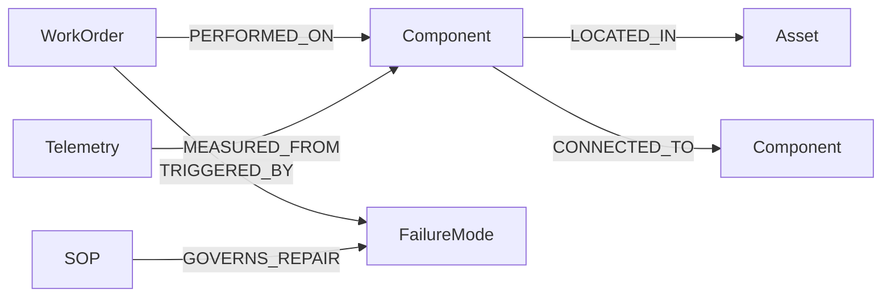

# Domain Ontology — Energy Infrastructure Maintenance (ISO 14224-adapted)

This is the property-graph ontology implemented in `src/graphrag/schema.py`. It follows the
dissertation plan (Part 1, Section 3) and borrows reliability/maintenance structuring from
ISO 14224 and OSDU entity concepts.

## Node labels

| Label         | Primary id   | Key attributes                                                        |
|---------------|--------------|-----------------------------------------------------------------------|
| `Asset`       | `asset_id`   | name, system_code, criticality_tier, installation_date, location      |
| `Component`   | `comp_id`    | name, type, model, manufacturer, design_pressure_bar, operating_temp_max_c, status |
| `WorkOrder`   | `wo_id`      | creation_date, issue_type, priority, cost_usd, duration_hours, resolved_by, summary, resolution |
| `Telemetry`   | `metric_id`  | timestamp, vibration_mm_s, temp_celsius, pressure_bar, flow_rate_m3h   |
| `SOP`         | `sop_id`     | title, revision, target_component_type, hazard_class, approved_year, body |
| `FailureMode` | `failure_id` | failure_code, name, symptom, root_cause_category, severity_index      |

## Relationship edges

| Source        | Relationship     | Target        | Meaning                              |
|---------------|------------------|---------------|--------------------------------------|
| `Component`   | `CONNECTED_TO`   | `Component`   | process flow (source feeds target)   |
| `Component`   | `LOCATED_IN`     | `Asset`       | spatial hierarchy                    |
| `WorkOrder`   | `PERFORMED_ON`   | `Component`   | maintenance history                  |
| `Telemetry`   | `MEASURED_FROM`  | `Component`   | sensor association                   |
| `WorkOrder`   | `TRIGGERED_BY`   | `FailureMode` | root-cause attribution               |
| `SOP`         | `GOVERNS_REPAIR` | `FailureMode` | guidance-document relationship       |

## Diagram

## Why `CONNECTED_TO` is directional

Flow direction is the backbone of the research question *"failure modes for pumps
**downstream** of Separator V-202."* The edge is stored source→target meaning *source feeds
target*, so:

- **downstream(X)** = follow `CONNECTED_TO` out-edges from X.
- **upstream(X)**   = follow `CONNECTED_TO` in-edges into X.

The generator (`data_generation.py`) deliberately builds a separator-rooted flow tree per
platform so these traversals return non-trivial, verifiable answers.
